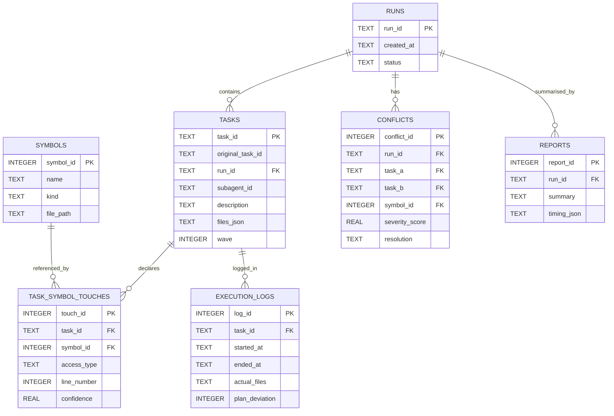

# Lockstep — Architecture

> Pre-Flight Conflict Guard for IBM Bob 2.0 Subagents

## Problem Statement

When Bob 2.0 spawns multiple subagents in parallel, two agents can each complete their individual task correctly and still break the system together. A study of 33,596 agent-authored pull requests across 2,807 repositories found that 79.4% of agent PRs occurred in overlapping parallel pairs; a separate dataset of 142,000+ agent PRs measured a 27.67% overall conflict rate — roughly double typical human PR conflict rates. Git sees no conflict (different files, no overlapping lines), but the merged result is semantically broken. Lockstep detects these collisions **before** subagents are spawned, directly from the plan that will spawn them.

---

## System Overview

```
Bob (Plan Mode)
      |
      | Plan JSON (Appendix A schema)
      v
 ┌─────────────┐
 │  Ingester   │  lockstep/ingester.py — validate + persist to SQLite
 └──────┬──────┘
        |
        v
 ┌─────────────┐
 │  Extractor  │  lockstep/extractor.py — AST walk: definitions + call sites
 └──────┬──────┘         + non-code resources (config keys, migration files)
        |
        v
 ┌─────────────┐
 │  Detector   │  lockstep/detector.py — pairwise touch-set intersection
 └──────┬──────┘         + weighted severity score
        |
        v
 ┌─────────────┐
 │  Scheduler  │  lockstep/scheduler.py — NetworkX topological_generations()
 └──────┬──────┘         → parallel-safe wave batches
        |
        v
 ┌─────────────┐
 │   Runner    │  lockstep/runner.py — asyncio.gather per wave → agent_fn
 └──────┬──────┘
        |
        v
 ┌─────────────┐
 │  Verifier   │  lockstep/verifier.py — post-run diff vs declared touch-set
 └──────┬──────┘
        |
        v
 ┌─────────────┐
 │   Report    │  lockstep/report.py — timing, conflicts, deviations
 └──────┬──────┘
        |
        v
 ┌─────────────────────────────┐
 │  FastAPI + WebSocket (api.py)│  real-time stage events → dashboard
 └─────────────────────────────┘
        |
        v
 ┌─────────────────────────────┐
 │  Vanilla JS + d3.js          │  lockstep/static/ — three-pane operations UI
 └─────────────────────────────┘
```

No LLM judgment is used in the analysis or scheduling path. All conflict and scheduling decisions are computed deterministically from the touch-set graph.

---

## Module Reference

| Module | Responsibility |
|---|---|
| `lockstep/ingester.py` | Validate Plan JSON (Appendix A schema); persist Run, Task, Symbol, TaskSymbolTouch to SQLite. Symbol deduplication by name. Task IDs stored as `{run_id}::{original_task_id}` for global uniqueness. |
| `lockstep/extractor.py` | Walk `.py` files with `ast` stdlib; find `FunctionDef`/`ClassDef` definitions and `ast.Call` call sites; classify access as `read`/`write`/`signature_change`; assign confidence (1.0 = direct AST hit, 0.7 = heuristic). Also scans config files (`.env`, `.yaml`, `.toml`) and migration files (`alembic/versions/`) as non-code resources. |
| `lockstep/detector.py` | Build bipartite task↔symbol graph; flag conflict when ≥2 tasks touch the same symbol and ≥1 access is `write` or `signature_change`; compute weighted severity score. |
| `lockstep/scheduler.py` | Build directed conflict `DiGraph` (writer→reader edges); call `networkx.topological_generations()` to produce wave batches; update `tasks.wave` column. |
| `lockstep/runner.py` | Execute tasks wave-by-wave using `asyncio.gather` for within-wave parallelism; call injectable `agent_fn` per task; invoke verifier after each wave; emit WebSocket events. |
| `lockstep/verifier.py` | Compare `actual_files` in execution results against `files_json` declared in plan; set `plan_deviation=1` for undeclared files; insert `execution_logs` rows. |
| `lockstep/report.py` | Assemble per-run report: task count, conflict count, wave list, conflict detail, deviations, naive-serial vs scheduled timing, `time_saved_ms`. |
| `lockstep/shim.py` | For `signature_change` conflicts: parse existing function signature with `ast`; infer new parameters from task description; generate a backward-compatible wrapper that accepts both old and new call signatures; write to `galaxium/shims/`; record cleanup task. |
| `lockstep/models.py` | SQLite DDL via raw SQL (no ORM); `create_tables()` + `get_connection()`. |
| `lockstep/api.py` | FastAPI app; all endpoints; `ConnectionManager` for WebSocket fan-out; `POST /runs` runs the full pipeline and streams stage events. |
| `lockstep/static/` | Vanilla JS + d3.js dashboard; three-pane layout; IBM Plex fonts; PRD §8 palette. |

---

## Data Model



Symbol `kind` values: `function` | `class` | `route` | `column` | `config_key` | `migration_file`

Access type values: `read` | `write` | `signature_change`

Conflict resolution values: `serialize` | `notify` | `shim`

---

## Severity Scoring Formula

Each detected conflict receives a severity score in [0, 1]:

```
severity = 0.40 × access_severity
         + 0.20 × blast_radius
         + 0.20 × centrality
         + 0.20 × confidence_penalty
```

| Factor | Weight | Description |
|---|---|---|
| `access_severity` | 0.40 | `signature_change`=1.0, `write`=0.7, `read`=0.4 |
| `blast_radius` | 0.20 | `min(call_site_count / 5, 1.0)` — saturates at 5+ call sites |
| `centrality` | 0.20 | NetworkX degree centrality of the symbol in the touch graph |
| `confidence_penalty` | 0.20 | `1 - min(confidence_a, confidence_b)` — low confidence raises severity |

Severity bands: `< 0.4` → low (safe), `0.4–0.7` → medium, `> 0.7` → high.

The PRD §10 scenario (`signature_change` × `read` on `calculateShipping`) scores **0.7333** — high severity, correctly serialized.

---

## API Reference

| Method | Path | Description |
|---|---|---|
| `POST` | `/runs` | Ingest Plan JSON, run full pipeline, return report. Query params: `generate_shim=true`, `execute=true` |
| `GET` | `/runs/{run_id}` | Return assembled report for a run |
| `GET` | `/runs/{run_id}/waves` | Return wave schedule with task details |
| `GET` | `/runs/{run_id}/conflicts` | Return conflict list with severity scores |
| `WS` | `/ws/{run_id}` | Real-time pipeline stage events |

Default mode for `POST /runs` is **analysis-only** (no subagent execution). Pass `?execute=true` to trigger the wave runner.

---

## WebSocket Protocol

Events emitted to connected dashboard clients as JSON objects:

| Event | When |
|---|---|
| `ingester_done` | Plan validated and persisted |
| `extractor_done` | Touch-sets enriched with AST data |
| `detector_done` | Conflicts computed (includes `conflict_count`) |
| `scheduler_done` | Waves assigned (includes `wave_count`) |
| `wave_{n}_done` | Wave N completed execution |
| `verifier_done` | Post-run deviation check complete |
| `report_done` | Final report assembled (includes full `report` dict) |

---

## Shim Resolution Mechanism

When a conflict has resolution=`shim` (opt-in via `?generate_shim=true`):

1. `lockstep/shim.py` reads the current function definition via `ast`.
2. New parameter names are inferred from the `signature_change` task's description using regex on backtick-quoted identifiers.
3. A wrapper function is generated that accepts both the old signature (new params default to `None`) and the new signature. When called with old args only, it forwards to the underlying new implementation; when called with new args, it passes them through.
4. The shim is written to `galaxium/shims/shim_{symbol_name}.py`.
5. A follow-up cleanup `Task` is recorded in the DB: `"Remove shim for {symbol} (galaxium/shims/shim_{symbol}.py)"`.
6. `conflicts.resolution` is updated to `shim`.

This allows both tasks to run in true parallel: Task 2 imports the shim (old API), Task 1 writes the new implementation, and the shim bridges the gap until both land and the cleanup task removes it.

---

## Demo Walkthrough

```
python demo.py
```

**Unscheduled path** (shows the problem):
1. Task 2 adds `getShippingEstimate()` calling `calculateShipping(weight, destination)` — old 2-arg API.
2. Task 1 changes `calculateShipping` to require `region` as a third argument, updating only the call sites it scanned *before* Task 2 ran.
3. Task 2's call site is left with the old signature — **TypeError at runtime**.

**Lockstep-scheduled path** (shows the fix):
1. Lockstep ingests the Section 10 plan, detects 1 conflict (severity=0.7333), and schedules Task 1 → Wave 0, Task 2 → Wave 1.
2. Task 1 runs first, updating the signature and all existing call sites.
3. Task 2 runs after, adding its endpoint with the new 3-arg API — **succeeds**.

---

## Benchmark Results

Precision = 1.000 · Recall = 1.000 across all four labeled fixtures:

| Fixture | Category | Expected | Actual | Result |
|---|---|---|---|---|
| `section10_plan.json` | True conflict | 1 | 1 | PASS |
| `looks_risky_but_safe.json` | Read-read | 0 | 0 | PASS |
| `resource_conflict.json` | Migration file | 1 | 1 | PASS |
| `no_relation.json` | Unrelated symbols | 0 | 0 | PASS |
