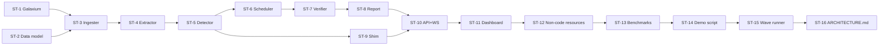

# Lockstep — Pre-Flight Conflict Guard for IBM Bob 2.0 Subagents
## Plan

**Scope:** Phase 1 (MVP) + Phase 2 (robustness + demo)
**Target repo to guard:** Galaxium Travels (scaffolded in this workspace)
**Status tracking:** each sub-task carries a `[ ] pending` / `[x] done` marker.

---

## Top-Level Overview

Lockstep is a deterministic pre-flight analysis pipeline that sits between Bob's Plan mode and Bob's subagent spawning. Given a structured Plan JSON, it:

1. Resolves every named symbol in the target repo using Python `ast` parsing.
2. Builds a pairwise conflict graph (touch-set intersection where at least one touch is write/signature_change).
3. Topologically batches tasks into parallel-safe waves.
4. Persists all data to SQLite.
5. Serves a three-pane dashboard with real-time WebSocket updates.
6. Verifies actual post-run diffs against declared touch-sets.
7. Supports shim generation for signature-change conflicts.

The Galaxium Travels repo is scaffolded alongside Lockstep as the concrete demo target, containing the exact `calculateShipping()` scenario from PRD Section 10.

No LLM judgment is used in the analysis or scheduling path — all decisions are graph-computed.

---

## Repository Layout (target end state)

```
/
├── galaxium/          # Sample target repo (FastAPI, SQLite, MCP)
│   ├── main.py
│   ├── shipping.py
│   ├── database.py
│   └── mcp_server.py
├── lockstep/          # The Lockstep tool
│   ├── models.py      # SQLAlchemy / SQLite data model
│   ├── ingester.py    # Plan JSON → DB
│   ├── extractor.py   # AST-based touch-set resolver
│   ├── detector.py    # Conflict detection + severity scoring
│   ├── scheduler.py   # Topological wave batcher
│   ├── verifier.py    # Post-run diff scanner
│   ├── shim.py        # Shim generator (Phase 2)
│   ├── report.py      # Report builder
│   ├── api.py         # FastAPI app + WebSocket hub
│   └── static/        # Vanilla JS + d3.js dashboard
│       ├── index.html
│       ├── app.js
│       └── style.css
├── benchmarks/        # Phase 2 labeled fixtures + runner
│   ├── fixtures/
│   └── run_benchmarks.py
├── demo.py            # Single-command demo script (Phase 2)
├── requirements.txt
└── ARCHITECTURE.md    # Auto-generated (Phase 2 FR2.7)
```

---

## Sub-Tasks

---

### ST-1 — Scaffold Galaxium Travels sample repo

**Status:** `[ ] pending`

**Intent**
Create the target repository that Lockstep will analyze. It must be realistic enough to exercise the full detector: a real FastAPI app with a SQLite-backed shipping module, MCP server interface, and — critically — the `calculateShipping()` function whose signature is the known conflict in Section 10.

**Expected Outcomes**
- `galaxium/shipping.py` contains `calculateShipping(weight, destination)` with at least three call sites in other files.
- `galaxium/main.py` exposes REST endpoints that call `calculateShipping()`.
- `galaxium/mcp_server.py` exposes the same operations as MCP tools.
- `galaxium/database.py` sets up a SQLite database with an orders table.
- The app runs (`uvicorn galaxium.main:app`) without errors.

**Todo List**
1. Create `galaxium/database.py`: SQLite setup via `sqlite3` stdlib, `orders` table (id, destination, weight, shipping_cost, region).
2. Create `galaxium/shipping.py`: `calculateShipping(weight, destination)` — the pre-conflict signature — plus helpers; include docstring marking the symbol for easy AST targeting.
3. Create `galaxium/main.py`: FastAPI app; endpoints `POST /order`, `GET /shipping-estimate`; both call `calculateShipping()`.
4. Create `galaxium/mcp_server.py`: MCP tool definitions wrapping the same shipping functions.
5. Add `requirements.txt` with `fastapi`, `uvicorn`, `networkx`, `sqlalchemy`, `mcp`, `pytest`, `httpx[asyncio]`.
6. Smoke-test that all imports resolve.

**Relevant Context**
- PRD §9: tech stack; PRD §10: exact symbol name and access pattern.
- The function must be written with the *old* (pre-conflict) signature so that later demo runs can show the unscheduled breakage.

---

### ST-2 — Data model and database setup (Lockstep)

**Status:** `[ ] pending`

**Intent**
Define the SQLite schema that persists every entity in the PRD §6 data model. All downstream modules read/write through this schema, so it must be defined before anything else in Lockstep.

**Expected Outcomes**
- `lockstep/models.py` defines ORM-style classes (SQLAlchemy Core or dataclasses + raw SQL) for: `Run`, `Task`, `Symbol`, `TaskSymbolTouch`, `Conflict`, `ExecutionLog`, `Report`.
- A `create_tables(db_path)` function initialises all tables in a fresh SQLite file.
- Foreign-key relationships match PRD §6 exactly.

**Todo List**
1. Choose persistence approach: SQLAlchemy Core (no ORM) with explicit table definitions — no external migrations framework needed for MVP.
2. Define `runs` table: `run_id TEXT PK`, `created_at`, `status`.
3. Define `tasks` table: `task_id TEXT PK`, `run_id FK`, `subagent_id`, `description`, `wave INTEGER`.
4. Define `symbols` table: `symbol_id INTEGER PK`, `name`, `kind`, `file_path`.
5. Define `task_symbol_touches` table: `touch_id PK`, `task_id FK`, `symbol_id FK`, `access_type` (read/write/signature_change).
6. Define `conflicts` table: `conflict_id PK`, `run_id FK`, `task_a`, `task_b`, `symbol_id FK`, `severity_score REAL`, `resolution` (serialize/notify/shim).
7. Define `execution_logs` table: `log_id PK`, `task_id FK`, `started_at`, `ended_at`, `actual_files TEXT`, `plan_deviation INTEGER`.
8. Define `reports` table: `report_id PK`, `run_id FK`, `summary TEXT`, `timing_json TEXT`.
9. Implement `create_tables(db_path: str)` and a thin `get_connection(db_path)` helper.
10. Write unit test: create tables, insert one row per table, assert round-trip.

**Relevant Context**
- PRD §6 data model.
- Use `TEXT` for JSON blobs (e.g., `timing_json`, `actual_files`) rather than separate junction tables for simplicity.

---

### ST-3 — Plan JSON ingester (FR1.1)

**Status:** `[ ] pending`

**Intent**
Parse and validate an incoming Plan JSON (Appendix A schema) and persist its `Run` and `Task` records to SQLite. This is the entry point for every Lockstep analysis run.

**Expected Outcomes**
- `lockstep/ingester.py` exposes `ingest_plan(plan_json: dict, db_path: str) -> str` (returns `run_id`).
- All tasks, symbols, and touches from the plan JSON are persisted before the function returns.
- Malformed JSON (missing required fields) raises a typed `LockstepIngestionError`.
- Unit test: ingest the Section 10 two-task plan fixture; assert correct row counts.

**Todo List**
1. Write `validate_plan(plan: dict)` — checks required top-level keys and per-task required fields; raises `LockstepIngestionError` with a descriptive message on failure.
2. Write `ingest_plan(plan_json, db_path)`: call `validate_plan`, open connection, insert `runs` row, then for each task insert `tasks`, upsert `symbols`, insert `task_symbol_touches`.
3. Symbol deduplication: if a symbol with the same `name + file_path` already exists in this run's context, reuse its `symbol_id`.
4. Write fixture: `benchmarks/fixtures/section10_plan.json` — the exact two-task plan from PRD §10.
5. Write unit test covering happy path and missing-field error.

**Relevant Context**
- PRD Appendix A schema.
- PRD §10 scenario — this fixture is reused by the detector test and the demo script.

---

### ST-4 — AST-based touch-set extractor (FR1.2)

**Status:** `[ ] pending`

**Intent**
For each task's declared symbols, walk the target repo's Python source with `ast` to confirm the symbol exists, find all its call sites, and enrich the touch-set with any additional implicit reads detected from the AST that the plan may not have declared.

**Expected Outcomes**
- `lockstep/extractor.py` exposes `extract_touch_set(task: dict, repo_root: str) -> list[TouchRecord]`.
- For each symbol in the task, the extractor produces a `TouchRecord` with: file path, line number, resolved access type, and a `confidence` float (1.0 = directly found by AST, lower if only heuristically inferred).
- The extractor correctly identifies all three `calculateShipping()` call sites in Galaxium.
- Unit test: run on Galaxium, assert the two-task fixture yields the correct touch records.

**Todo List**
1. Write `find_symbol_definition(symbol_name, kind, repo_root)` — walks `.py` files, returns file + line of the `def` (for functions) or `class` statement.
2. Write `find_call_sites(symbol_name, repo_root)` — walks `.py` files, yields `(file, line)` for every `ast.Call` whose func name matches.
3. Write `classify_access(symbol_name, file_path, task_files)` — if the file is in `task.files` and the task declares `signature_change`, return `signature_change`; if in task files and declares `write`, return `write`; else `read`.
4. Write `extract_touch_set(task, repo_root)` composing the above; attach `confidence` (1.0 for direct AST hits, 0.7 for heuristic inference).
5. Unit test: extract touches for both Section 10 tasks; assert Task 1 yields `signature_change` on `calculateShipping` and Task 2 yields `read`.

**Relevant Context**
- PRD §7 FR1.2.
- Python `ast` stdlib only — no third-party AST libraries.
- Confidence field feeds into Phase 2 severity scoring (FR2.2).

---

### ST-5 — Conflict detector (FR1.3 + FR2.2)

**Status:** `[ ] pending`

**Intent**
Compare touch-sets pairwise to identify conflicts, persist them, and assign a weighted severity score (Phase 2 FR2.2 built in from the start to avoid a refactor).

**Expected Outcomes**
- `lockstep/detector.py` exposes `detect_conflicts(run_id: str, db_path: str) -> list[Conflict]`.
- A conflict is flagged whenever symbol S is touched by task A and task B, and at least one touch is `write` or `signature_change`.
- Each conflict record carries a `severity_score` (float 0–1) computed from: access severity weight, call-site count (blast radius), symbol centrality in the touch graph, and extractor confidence (lower confidence → higher effective severity).
- The Section 10 scenario produces exactly one conflict: Task 1 × Task 2 on `calculateShipping`, `signature_change` × `read`, high severity.
- Unit test: run on ingested Section 10 fixture; assert conflict count = 1, severity > 0.7.

**Todo List**
1. Load all `task_symbol_touches` for the run; build an in-memory mapping `symbol_id → list[touch]`.
2. For each symbol touched by ≥ 2 tasks, check the access-type rule; create `Conflict` records.
3. Severity scoring formula:
   - `access_severity`: signature_change = 1.0, write = 0.7, read (vs write) = 0.4.
   - `blast_radius`: normalize call-site count (from extractor) across all symbols; 0–1.
   - `centrality`: NetworkX degree centrality of the symbol in the touch graph; 0–1.
   - `confidence_penalty`: `1 - min(confidence_a, confidence_b)` (low confidence raises severity).
   - Final score: `0.4 * access_severity + 0.2 * blast_radius + 0.2 * centrality + 0.2 * confidence_penalty`.
4. Persist conflict rows to `conflicts` table with `resolution = 'serialize'` by default (shim logic is in ST-9).
5. Unit test asserting Section 10 produces exactly one conflict with severity > 0.7.

**Relevant Context**
- PRD §7 FR1.3, FR2.2.
- NetworkX is already in requirements for the scheduler (ST-6).

---

### ST-6 — Wave scheduler (FR1.4)

**Status:** `[ ] pending`

**Intent**
Convert the conflict graph into a topologically ordered sequence of parallel-safe execution waves. Tasks with no conflict edges between them share a wave; conflicting pairs are ordered writer-before-reader across waves.

**Expected Outcomes**
- `lockstep/scheduler.py` exposes `schedule_run(run_id: str, db_path: str) -> list[list[str]]` — returns an ordered list of waves, each wave a list of task IDs.
- The Section 10 scenario produces two waves: Wave 0 = [task_1], Wave 1 = [task_2].
- Each task's `wave` column in the `tasks` table is updated.
- Unit test: Section 10 → two waves in correct order.

**Todo List**
1. Load all conflicts for the run; build a directed NetworkX `DiGraph` with edges writer → reader.
2. Use `networkx.topological_generations()` to produce wave groups.
3. Tasks with no conflict edges are assigned to Wave 0.
4. Update `tasks.wave` for each task.
5. Return the wave list.
6. Unit test: assert Section 10 two-wave output.

**Relevant Context**
- PRD §7 FR1.4.
- `topological_generations` handles multi-level dependency chains beyond the two-task example.

---

### ST-7 — Post-execution verifier (FR1.5)

**Status:** `[ ] pending`

**Intent**
After subagents run, diff the actual changed files against each task's declared touch-set. Flag any task that touched files or symbols outside its declaration as a plan deviation.

**Expected Outcomes**
- `lockstep/verifier.py` exposes `verify_run(run_id: str, execution_results: list[dict], db_path: str)`.
- Each `execution_result` provides `task_id`, `actual_files_changed: list[str]`, `started_at`, `ended_at`.
- Any file in `actual_files_changed` that is not covered by the task's declared `files` list sets `plan_deviation = 1` and is logged.
- `execution_logs` rows are inserted.
- Unit test with a mock result where one task touches an extra file.

**Todo List**
1. Accept execution results; for each task, load its declared files from the plan.
2. Compute `extra_files = actual_files - declared_files`; set `plan_deviation = 1` if non-empty.
3. Insert `execution_logs` rows.
4. Optionally re-run the AST extractor on actual changed files and surface any new touches not in the declared touch-set.
5. Unit test: one task with an extra file touched → `plan_deviation = 1`.

**Relevant Context**
- PRD §7 FR1.5.

---

### ST-8 — Report generator (FR1.6 + FR2.6)

**Status:** `[ ] pending`

**Intent**
Assemble the final per-run report from all persisted data: conflict summary, wave schedule, timing comparison (naive serial vs. actual scheduled), and plan deviations.

**Expected Outcomes**
- `lockstep/report.py` exposes `build_report(run_id: str, db_path: str) -> dict`.
- Report contains: `run_id`, `task_count`, `conflict_count`, `waves`, `conflicts` (detail), `deviations`, `timing` (`naive_serial_ms`, `scheduled_ms`, `time_saved_ms`).
- Report is persisted to `reports` table as JSON.
- Unit test: build report for Section 10 run; assert conflict_count = 1, waves = 2.

**Todo List**
1. Load run, tasks, conflicts, execution_logs from DB.
2. Compute timing: `naive_serial_ms` = sum of all task durations; `scheduled_ms` = wall-clock span from first start to last end across waves; `time_saved_ms` = difference.
3. Assemble report dict; serialize to JSON and persist.
4. Unit test.

**Relevant Context**
- PRD §7 FR1.6, FR2.6.

---

### ST-9 — Shim generator (FR2.5)

**Status:** `[ ] pending`

**Intent**
For `signature_change` conflicts, generate a temporary backward-compatible compatibility shim so both tasks can run in true parallel, with a recorded follow-up cleanup task.

**Expected Outcomes**
- `lockstep/shim.py` exposes `generate_shim(conflict: Conflict, repo_root: str) -> ShimResult`.
- For the `calculateShipping` conflict: generates a wrapper `calculateShipping(weight, destination, region=None)` that calls the new signature with a sensible default, writes it to a `shim_<symbol>.py` file, and records a follow-up task to remove the shim after both tasks merge.
- Conflict resolution is updated to `shim` in the DB.
- Unit test: shim generated for Section 10 conflict; shim file is valid Python; old 2-arg call still works.

**Todo List**
1. Parse the existing function signature from the repo using `ast`.
2. Detect the new parameter(s) declared in the `signature_change` task's plan description.
3. Generate a shim wrapper with `**kwargs` or explicit default values for new required params.
4. Write shim to `galaxium/shims/shim_<symbol_name>.py`.
5. Record a follow-up cleanup `Task` in the DB with `description = "Remove shim for <symbol>"`.
6. Update `conflicts.resolution = 'shim'`.
7. Unit test: generated file is parseable by `ast.parse`; calling with old args does not raise.

**Relevant Context**
- PRD §7 FR2.5.
- Shim is optional (only generated when the user/API requests it, not by default).

---

### ST-10 — FastAPI backend + WebSocket hub (FR1.7 + FR2.3)

**Status:** `[ ] pending`

**Intent**
Expose Lockstep's pipeline as a FastAPI service so the dashboard can trigger runs, poll state, and receive real-time updates as each pipeline stage completes.

**Expected Outcomes**
- `lockstep/api.py` provides: `POST /runs` (ingest plan), `GET /runs/{run_id}` (report), `GET /runs/{run_id}/waves` (schedule), `GET /runs/{run_id}/conflicts`, `WebSocket /ws/{run_id}` (real-time stage events).
- WebSocket pushes a JSON event at each pipeline stage completion: `extractor_done`, `detector_done`, `scheduler_done`, `verifier_done`, `report_done`.
- `POST /runs` with `?generate_shim=true` triggers ST-9 shim logic.
- Unit test: POST a plan, assert 200 and run_id returned; GET the report.

**Todo List**
1. Create `lockstep/api.py` with a FastAPI `app` instance.
2. Implement `POST /runs`: validate + ingest → extract → detect → schedule → (optional shim) → build report; stream WebSocket events at each stage.
3. Implement `GET /runs/{run_id}` returning the report JSON.
4. Implement `GET /runs/{run_id}/waves` returning the wave list with task details.
5. Implement `GET /runs/{run_id}/conflicts` returning conflict list with severity scores.
6. Implement `WebSocket /ws/{run_id}`: keep connection open during the pipeline; push stage-completion events.
7. Add a `ConnectionManager` class for WebSocket fan-out (supports multiple dashboard clients per run).
8. Unit test: `httpx.AsyncClient` against the FastAPI app; POST plan → GET report round-trip.

**Relevant Context**
- PRD §7 FR1.7, FR2.3.
- FastAPI's built-in WebSocket support; no external WS library needed.

---

### ST-11 — Three-pane dashboard (FR1.7 + FR2.3)

**Status:** `[ ] pending`

**Intent**
Build the operations dashboard per the exact UI/UX spec in PRD §8: fixed three-pane layout (task list / dependency graph / detail panel), IBM Plex fonts, specified hex palette, real-time WebSocket updates, d3.js force graph.

**Expected Outcomes**
- `lockstep/static/index.html` loads with the correct font and colour scheme.
- Left pane: task list with wave badge, severity badge (colour-coded per palette).
- Centre pane: d3.js force-directed graph of tasks and symbols; edges colour-coded by conflict severity; nodes selectable.
- Right pane: detail panel showing selected task or conflict's full metadata.
- WebSocket connection established on page load; each pipeline event animates the relevant node.
- No React, no Tailwind, no gradients, no drop shadows, no emoji icons, no purple.

**Todo List**
1. Create `lockstep/static/index.html`: three-column CSS grid layout; import IBM Plex Mono + IBM Plex Sans from Google Fonts; apply exact palette as CSS custom properties.
2. Create `lockstep/static/style.css`: define all colour variables; panel, border, text styles; zero gradients/shadows.
3. Create `lockstep/static/app.js`:
   a. On load: `GET /runs/{run_id}` to populate task list and conflict list.
   b. Open WebSocket `/ws/{run_id}`; on each event update the relevant UI element.
   c. d3.js force simulation: nodes = tasks + symbols; edges = touch relationships; thickness/colour = severity.
   d. Click handler on nodes → populate detail panel.
4. FastAPI serves `/static` via `StaticFiles` mount.
5. Manual review: open dashboard in browser, submit Section 10 plan via curl, verify all three panes populate and WebSocket events update the graph in real time.

**Relevant Context**
- PRD §8 (binding UI requirements).
- d3.js loaded from CDN; no npm build step.
- Palette: bg `#0B0E14`, panel `#141822`, border `#242B3A`, text `#E8EAED`, muted `#8B93A7`, safe `#2BB3A3`, medium `#F5A623`, high `#D64545`.

---

### ST-12 — Non-code resource conflict support (FR2.4)

**Status:** `[ ] pending`

**Intent**
Extend the touch-set model and detector to handle config keys and migration/schema files — resources that are not AST symbols but still cause real conflicts when two tasks modify them. Must be complete before the benchmark suite can run its `resource_conflict` fixture.

**Expected Outcomes**
- `symbols` table supports `kind = 'config_key'` and `kind = 'migration_file'`.
- `lockstep/extractor.py` includes a `scan_non_code_resources(task, repo_root)` function that walks known config files (`.env`, `*.yaml`, `*.toml`, `alembic/versions/*.py`) and flags any that appear in the task's `files` list.
- Conflicts on non-code resources are detected by the same detector logic (same write-wins rule).
- `resource_conflict.json` benchmark fixture can be ingested and detected correctly.

**Todo List**
1. Add `kind` values `config_key` and `migration_file` to the `symbols` schema in `lockstep/models.py`.
2. In `extractor.py`, add `scan_non_code_resources(task, repo_root)`: check task's `files` list for config/migration file paths; register them as symbols of the appropriate kind.
3. Detector already handles all symbol kinds generically — no changes needed there.
4. Add a sample `.env` and `alembic/` stub to Galaxium so the extractor has something to scan.
5. Verify that `resource_conflict.json` benchmark fixture is detectable end-to-end.

**Relevant Context**
- PRD §7 FR2.4.
- This sub-task was formerly ST-13; it is now sequenced *before* the benchmark suite (formerly ST-12) because the benchmark's `resource_conflict` fixture depends on this functionality.

---

### ST-13 — Benchmark suite (FR2.1)

**Status:** `[ ] pending`

**Intent**
Create a labeled fixture set covering the four PRD-specified categories and a runner that measures precision and recall. The suite must pass at 100% precision/recall before the demo is recorded.

**Expected Outcomes**
- `benchmarks/fixtures/` contains at least four JSON fixture files, one per category: `true_conflict.json` (Section 10 scenario), `looks_risky_but_safe.json`, `resource_conflict.json` (config key or migration file), `no_relation.json`.
- `benchmarks/run_benchmarks.py` runs all fixtures, calls the detector, checks actual vs. expected conflict flags, prints precision/recall, exits non-zero on failure.
- All four fixtures pass with precision = 1.0, recall = 1.0.

**Todo List**
1. Design `looks_risky_but_safe.json`: two tasks touching the same symbol but both access_type = read — no conflict expected.
2. Design `resource_conflict.json`: two tasks touching a config key or migration file — conflict expected (FR2.4 extension: non-code resource conflict).
3. Design `no_relation.json`: two tasks touching entirely different symbols — no conflict expected.
4. Write `run_benchmarks.py`: for each fixture, ingest → detect → compare result to `expected_conflicts` field in fixture; accumulate TP/FP/FN; print and assert precision = recall = 1.0.
5. Ensure `resource_conflict` fixture exercises the non-code resource path (FR2.4).

**Relevant Context**
- PRD §7 FR2.1, FR2.4.
- The Section 10 fixture from ST-3 is reused as `true_conflict.json`.
- ST-12 (non-code resources) must be complete before this suite can achieve 100% precision/recall.

---

### ST-14 — Demo script (FR2.8)

**Status:** `[ ] pending`

**Intent**
A single `python demo.py` command that deterministically shows both the broken (unscheduled) run and the corrected (Lockstep-scheduled) run, producing visible output comparing the two outcomes.

**Expected Outcomes**
- `demo.py` is a self-contained script with no interactive prompts.
- **Unscheduled run:** applies Task 2 (`getShippingEstimate` endpoint calling old signature) before Task 1 (signature change); verifies the call fails at import/call time; prints "BROKEN — call site uses old signature".
- **Scheduled run:** ingests the Section 10 plan via Lockstep, runs Wave 0 (Task 1) then Wave 1 (Task 2); verifies the endpoint works; prints "FIXED — Lockstep-scheduled run succeeded".
- Script exits 0 only if both assertions hold (broken without, fixed with).

**Todo List**
1. Write helper `apply_task_1(repo_root)`: programmatically edits `shipping.py` to add the `region` parameter **and** updates all existing call sites in `main.py` and `mcp_server.py` to pass `region` — matching the PRD §10 requirement that Task 1 updates every call site.
2. Write helper `apply_task_2(repo_root)`: adds the `getShippingEstimate()` endpoint calling `calculateShipping()` without `region` (simulates Task 2 written against the old signature).
3. Write helper `reset_repo(repo_root)`: reverts Galaxium to its original state (git checkout or file copy).
4. **Unscheduled path:** reset → apply Task 2 → apply Task 1 → attempt import → assert `TypeError`; print "BROKEN".
5. **Scheduled path:** reset → POST Section 10 plan to Lockstep API → receive waves → apply Task 1 → apply Task 2 → attempt import → assert success; print "FIXED".
6. `reset_repo` at end for a clean workspace.
7. Exit 0 on success.

**Relevant Context**
- PRD §7 FR2.8, §11 success criteria.
- Must be runnable with `python demo.py` from repo root.

---

### ST-15 — Wave runner — Bob Agent handoff (PRD §5 pipeline)

**Status:** `[ ] pending`

**Intent**
Implement the component that bridges the scheduler's wave output to actual Bob Agent-mode subagent execution. For each wave, it submits the wave's task list to Bob Agent mode (or simulates this in the demo context), waits for all tasks in the wave to complete, records execution results, then advances to the next wave. This is the step PRD §5 calls "Bob (Agent Mode, spawns subagents per wave)" — it was absent from the original plan.

**Expected Outcomes**
- `lockstep/runner.py` exposes `execute_waves(run_id: str, waves: list[list[str]], db_path: str, repo_root: str, agent_fn: Callable)`.
- `agent_fn` is an injectable callback so the demo script and real Bob integration can each provide their own implementation (demo uses `apply_task_1` / `apply_task_2` helpers; real use passes Bob's subagent spawner).
- After each wave completes, the runner calls `verify_run()` (ST-7) with the actual changed files.
- Wave progress events are emitted over the WebSocket hub so the dashboard reflects live wave advancement.
- Unit test: mock `agent_fn` that records call order; assert Task 1 called before Task 2 for Section 10 plan.

**Todo List**
1. Create `lockstep/runner.py` with `execute_waves(run_id, waves, db_path, repo_root, agent_fn)`.
2. For each wave: call `agent_fn(task)` for each task in the wave (concurrently within a wave using `asyncio.gather`); collect returned `execution_result` dicts.
3. After each wave: call `verifier.verify_run()` with that wave's results; emit `wave_{n}_done` WebSocket event.
4. Update `api.py` `POST /runs` to call `execute_waves` when an `execute=true` query param is provided (default: analysis-only mode that just returns the schedule without running).
5. Update `demo.py` to inject the `apply_task_*` helpers as `agent_fn`.
6. Unit test: mock agent; assert Section 10 ordering.

**Relevant Context**
- PRD §5 system architecture pipeline.
- `asyncio.gather` for true within-wave parallelism.
- `execute=false` (analysis-only) is the default API mode so the tool can be used for planning without triggering any side effects.

---

### ST-16 — Auto-generate ARCHITECTURE.md (FR2.7)

**Status:** `[ ] pending`

**Intent**
Exercise Bob's document-understanding capability: produce a `ARCHITECTURE.md` that accurately describes the final built system by reading the source tree and cross-referencing the PRD.

**Expected Outcomes**
- `ARCHITECTURE.md` describes: system overview, data flow through the pipeline, each module's responsibility, the data model, API endpoints, WebSocket protocol, and the two-phase build structure.
- Content is grounded in the actual implemented code, not just the PRD.
- No hallucinated modules or endpoints.

**Todo List**
1. After all other sub-tasks are complete, use Bob (Plan/Agent mode) to read `lockstep/`, `galaxium/`, and `PRD.md`.
2. Produce `ARCHITECTURE.md` structured as: Overview → System Diagram (ASCII) → Module Reference → Data Model → API Reference → WebSocket Protocol → Demo Walkthrough.
3. Cross-check every module listed against the actual file tree.

**Relevant Context**
- PRD §7 FR2.7.
- This is the final sub-task; it requires all others to be complete (now ST-1 through ST-15).

---

## Execution Order



Key parallelism notes:
- ST-1 and ST-2 have no dependency on each other — can be implemented simultaneously.
- ST-9 (shim) can be built any time after ST-5 — no dependency on ST-6 through ST-11.
- ST-12 (non-code resources) must complete before ST-13 (benchmarks) because the `resource_conflict` fixture requires FR2.4 support.
- ST-15 (wave runner) is positioned after the demo script because `demo.py` defines the `agent_fn` interface that the runner must accept.

---

## Open Decisions (resolved)

| # | Decision | Resolution |
|---|----------|------------|
| 1 | Galaxium Travels in same workspace or external? | Scaffolded as sub-directory in this workspace. |
| 2 | Phase 1 only or full? | Phase 1 + Phase 2 in this plan. |
| 3 | SQLAlchemy ORM vs. Core vs. raw sqlite3? | SQLAlchemy Core (no ORM, no migrations framework). |
| 4 | Shim on by default or opt-in? | Opt-in via `?generate_shim=true` query param. |
| 5 | Severity formula open? | Specified in ST-5 with four weighted factors. |
| 6 | Wave runner injectable `agent_fn` or hardcoded Bob API call? | Injectable callback — demo injects file-edit helpers; real Bob integration injects its subagent spawner. |
| 7 | API default: execute waves or analysis-only? | Analysis-only by default; `?execute=true` triggers wave execution to avoid accidental side effects. |

---

## PRD Cross-Verification Log

All requirements verified on: initial plan review.

| PRD Ref | Requirement summary | Gap found | Fixed in |
|---|---|---|---|
| §5 pipeline | Wave runner — Bob Agent mode handoff | GAP 1 — missing sub-task | ST-15 added |
| §9 tech stack | `pytest` + `httpx` missing from requirements | GAP 2 — omission | ST-1 todo 5 patched |
| §10 scenario | `apply_task_1` must update all call sites | GAP 3 — partial spec | ST-14 todo 1 patched |
| Benchmark order | ST-12 depended on ST-13 but came before it | GAP 4 — ordering error | ST-12 ↔ ST-13 swapped |
